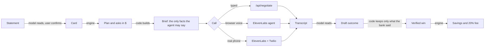

# Haggle

**Missed a credit card payment? Haggle calls your bank and gets the money back.**

An AI agent on the borrower's side. It reads your statement, works out what the debt costs and which asks are worth making, then calls the bank, by real phone, in English or Spanish. It asks for the late fee back, the old rate back and the late mark kept off your credit report. You pay 20% of what it saves you in the first year, only after a verified win.

**Live:** https://haggle-pi.vercel.app · no login · Zimran Business Cup 2.0, Money track

## Try it in 60 seconds

Open **https://haggle-pi.vercel.app/demo**. It loads Maria's sample case, labelled as sample data, and starts a call where **you play the bank**.

- **Real phone call:** type your phone number (+1 or +7) and press **Call my phone**. Your phone rings. You're the Chase rep, and your script is on screen.
  - Add a second phone as the cardholder, then say "I need to speak with the cardholder". Haggle rings that phone and connects it.
- **No phone handy:** pick **Typing** and tap the suggested bank replies.
- **End the call.** The result page shows only what the bank actually said, checked by code. Maria's example ends at **$271 saved in the first year and a $54.20 fee**. Payment is a Stripe test checkout (card `4242 4242 4242 4242`).

## Why

- **92%** of people who asked to have a late fee waived got it, and **84%** who asked for a lower APR got one, with an average cut of **6.3 points** (LendingTree survey, Sep 2026, via [FOX 5 NY](https://www.fox5ny.com/money/credit-cardholders-lower-interest-rates-waived-fees-lendingtree-survey) and [KKTV](https://www.kktv.com/2026/09/02/asking-lower-credit-card-rate-is-working-more-often-survey-finds/)).
- Americans carry **$1.285 trillion** in card balances ([New York Fed, Q3 2026](https://www.newyorkfed.org/newsevents/news/research/2026/20261110)) at an average **22.36% APR** on accounts charged interest ([Fed G.19](https://www.federalreserve.gov/releases/g19/current/)).
- Banks say yes when you ask. Most people never make the call: the hold, the menu, not knowing what to ask for.

## What it does

| | |
|---|---|
| **Read** | Upload a statement (PDF or photo), try a sample, or type the numbers. The model reads it and you confirm what was read. Only the last 4 card digits are kept. |
| **Plan** | A tested engine prices the debt and ranks the asks in dollars: late fee refund, APR back, lower APR, fee waivers, limit increase, balance transfer last. |
| **Call** | The agent calls by real phone (Twilio + ElevenLabs) or in the browser, in English or Spanish, with natural voices. It asks one thing at a time, counters twice before accepting a partial yes, and asks for a supervisor once. |
| **Your words** | "Ask for something else": type what the call is for, and the agent pursues it. |
| **Handoff** | If the bank insists on the cardholder, the agent rings the cardholder's phone, connects them and leaves the call. |
| **Live coach** | When you're on with the bank yourself, Haggle listens (phone on speaker) and shows what to say next: a "Say this" line, what to avoid, and each offer graded against your ask. |
| **Verify** | A model reads the transcript, and code keeps only numbers the bank itself said, including numbers said in words ("forty dollars", "veintisiete punto dos"). |
| **Pay on a win** | 20% of first-year savings, only on a verified win. Stripe test mode. |
| **Share** | A signed win card for X, LinkedIn and stories. The server re-checks the call before signing it. |
| **Stay on it** | Dashboard, call history, savings and alerts for when a promo ends or a rate goes up. |

## Honest by design

The agent:
- says it's an AI assistant and that the call is recorded;
- states only facts from the statement or from what the user typed. It never invents a hardship, an excuse, a competitor offer or a deadline. The reason for a missed payment is picked by the user from a list of real reasons;
- never gives personal data and never pretends to be the cardholder. It brings the cardholder in to verify.

On the money side:
- **Every number the user sees comes from the engine.** The model reads, speaks and writes; it never does arithmetic.
- **Model output is untrusted:** every reply is checked with zod and cross-checked against the engine or the transcript.

## How a call works



## Built with

Next.js 16 (App Router), TypeScript strict, Tailwind v4, framer-motion · Claude for reading statements and transcripts, the typed agent and the live coach · ElevenLabs Agents (voice, phone, live speech-to-text) · Twilio · Stripe · Vercel.

**836 tests** (vitest and fast-check). Typecheck and lint are clean.

## Safety limits on the public demo

- Phone calls go only to numbers starting with the codes in `PHONE_OPEN_PREFIXES` (+1 and +7 on the live site). Premium-rate lines are never rung.
- Each number rings at most 3 times an hour. There's a daily cap for the whole server and a per-visitor rate limit.
- Every call starts with the AI and recording disclosures, and ends by itself after about 5 minutes.
- No login. Data stays in the browser's local storage.

## Run it

```bash
pnpm install
```

```bash
pnpm dev
```

```bash
pnpm vitest run
```

Keys go in `.env.local`. `.env.example` lists every variable. Each feature shows a plain "not configured" state when its key is missing. No feature returns canned results.

## Map

| area | path |
|---|---|
| debt math, levers, plan, savings | `src/lib/engine` |
| agent brief, prompt, outcome check, coach | `src/lib/negotiator` |
| voice, phone, handoff | `src/lib/voice` |
| statement reading | `src/lib/statement` |
| sourced market figures | `src/lib/benchmarks` |
| call, coach, result screens | `src/components/call`, `src/components/win` |
| landing | `src/components/landing-v2` |
